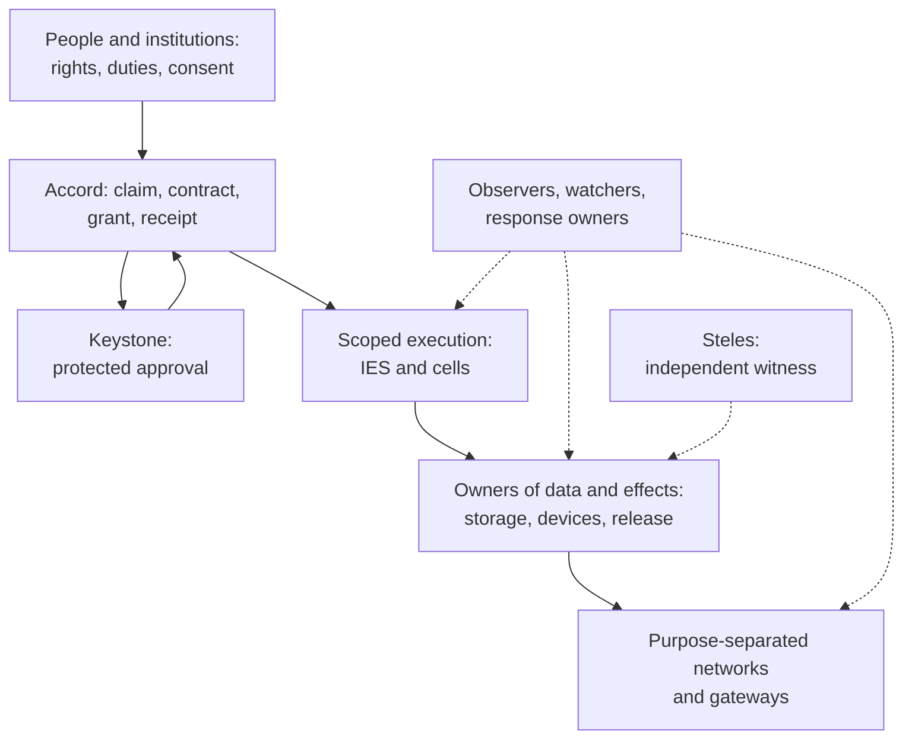
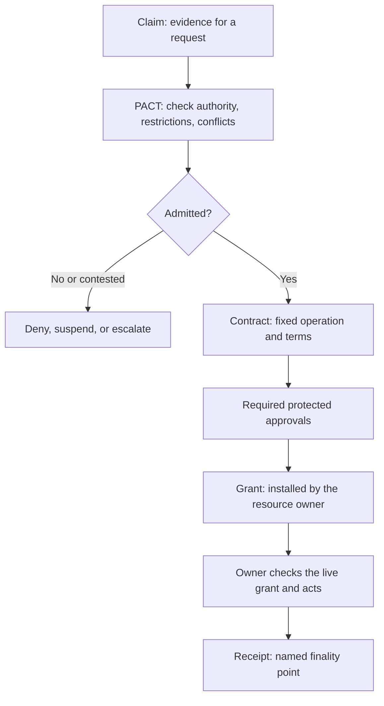
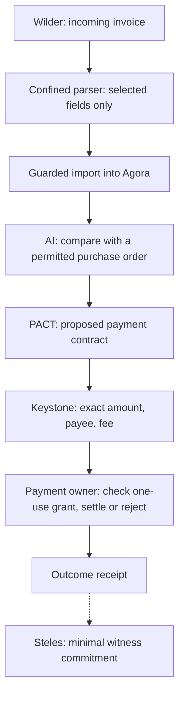
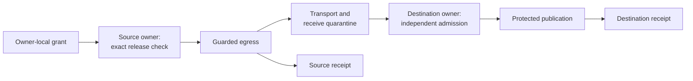

**What if a computer could only do what someone with the right to allow it had actually allowed, and could then show you what really happened?**

ASKA is a long-range vision for rebuilding the computer and the network around that one idea. A program may read a document without being able to send it anywhere. A network may carry a request without that request becoming permission. An AI assistant may prepare a payment without ever holding the power to approve it. A security system may notice an attack without gaining the power to take over the machine it watches.

> **ASKA v6 is an architecture specification and research program.** It is not a product, not manufactured hardware, not formally verified, and not certified. It is a coherent, testable target: named attackers, numbered requirements, test oracles, and an explicit list of what is still unknown.

[Read the specification on GitHub](https://github.com/nshkrdotcom/ASKA) · [Start with the system architecture](https://github.com/nshkrdotcom/ASKA/blob/main/01_system_architecture.md)

## The problem: authority leaks

Most of today's breaches are not failures of cryptography. They are failures of **reach**. A document viewer can see the whole disk. A browser tab inherits the user's network. A signed driver runs with the kernel's power. An AI agent with an API token can do whatever the token allows, including things nobody intended. A message that *looks* like it came from your bank is treated as if it carries your bank's authority.

The root cause is **ambient authority**: power that comes from where code happens to run, rather than from an explicit, limited, accountable grant. Patching individual bugs does not fix it. Every new app, model, update, or network peer adds reach, and that reach adds up.

ASKA's answer is not one clever mechanism. It is a system-wide discipline, applied from the silicon to the institution:

> **Every consequence has an owner. The owner acts only under explicit, bounded authority. Authority never grows by accident. Outcomes are recorded honestly, including uncertainty.**

## The vision in six ideas

1. **Scoped execution.** Work runs in physically assigned compute and memory domains, called *Isolated Execution Stacks* (IES), inside short-lived *cells*. A fully compromised program, kernel, or model stays inside what it was given.
2. **Authority is explicit and never expands.** Permission is a specific, limited, expiring *grant* installed where the resource lives. Names, pointers, routes, prompts, credentials, and signatures do not create rights on their own.
3. **Purpose-separated life.** Private (**Sanctum**), civic (**Polis**), commercial (**Agora**), and untrusted (**Wilder**) activity are kept apart, with an independent witness (**Steles**) beside them. Moving anything between them takes a deliberate release by the source *and* a separate acceptance by the destination.
4. **Protected human consent.** A trusted path (**Keystone**) shows people the real consequence of an action: who, what, how much, and for how long. Their approval binds to exactly that action and nothing else.
5. **Watching without ruling.** Independent observers and *watchers of the observers* detect problems and propose bounded responses. Evidence alone never becomes power over the thing being watched.
6. **Honest accountability.** Every outcome has a receipt that says precisely what is established: attempted, executed, committed, disclosed, or delivered. "Uncertain" is a first-class answer, not something to paper over.

Solid arrows show how authority flows into action. Dotted arrows show evidence and oversight, which inform decisions but never carry authority on their own.

## What kind of claim this is

ASKA is deliberately ambitious, and it is just as deliberate about its limits. The detail below is there to show the vision can be made precise, not to suggest it is finished.

- **It builds on established ideas.** Capability-based protection, separation kernels, least privilege, and MILS are decades old, and the specification cites them. It claims no originality for renaming them. What it proposes to test is the *combination*: owner-enforced effects, two-sided admission, independent observation, and physically inspectable paths, all working together across hardware, software, network, and institutions.
- **It assumes things go wrong.** Every attack campaign starts with a named component *already compromised*: a kernel, a device, a signed update, an administrator, a security monitor, an AI planner, an authorized insider. The question is never "can we keep attackers out?" It is "what can they reach, and does legitimate work keep running?"
- **It does not promise perfection.** Revocation cannot make someone forget data they already received. A signature proves who signed, not that an order is just. Separate software is not separate hardware. Physical separation reduces leakage but does not prove zero leakage. Wherever a guarantee is weaker than it sounds, the specification says so.
- **It is modest about institutions.** ASKA can enforce a bounded, admitted decision and preserve evidence of its basis. It cannot settle the law of every jurisdiction, and it cannot guarantee that every institution is honest or every order correct.

---

## Part I: The shape of the system

### Accord: from a request to an authorized action

The **Accord** system turns human-level rights and duties into machine-enforceable permission. **PACT** (Protocol for Authority, Consent, and Transactions) negotiates each request through four records that are never collapsed into each other:

| Record | What it is | What it is *not* |
|---|---|---|
| **Claim** | Evidence: identity, a relationship, a duty, a legal basis | Access. A claim alone opens nothing. |
| **Contract** | The admitted terms: participants, affected data or devices, restrictions, required approvals | Permission to act. It still has to be installed. |
| **Grant** | A bounded machine right, installed by the owner of the resource it governs | Transferable or self-expanding. It stays within its limits. |
| **Receipt** | A record of a named finality point: executed, committed, disclosed, delivered | Proof of anything beyond that named point. |

A grant names the operation, the data, the recipients, the expiry, and the resource budget. The component that owns the data or controls the final effect checks it at the moment of action. Rewriting a pointer, route, prompt, or descriptor cannot create a right to someone else's resources. This is the specification's **non-expansion** property: authority can be narrowed, delegated within limits, and revoked, but it never grows by accident.

When claims conflict, for example a guardian, a clinician, and an institution with different obligations, PACT records the conflict and follows the applicable procedure: deny, suspend, or refer for review. The machine does not quietly pick a winner.

[Authority calculus](https://github.com/nshkrdotcom/ASKA/blob/main/06_authority_calculus_and_nonexpansion.md) · [Accord system](https://github.com/nshkrdotcom/ASKA/blob/main/27_accord_system_and_machine_authorization.md) · [PACT protocol](https://github.com/nshkrdotcom/ASKA/blob/main/28_authority_schemas_and_pact_protocol.md) · [Identity and delegation](https://github.com/nshkrdotcom/ASKA/blob/main/29_identity_relationships_delegation_and_revocation.md)

### Purpose planes: separating the parts of a life

People act in different capacities: as a private person, a citizen, a customer or employee, and a visitor to the open Internet. ASKA makes those capacities into enforceable boundaries.

| Purpose | Role | The boundary that still matters |
|---|---|---|
| **Sanctum** | Private personal, family, and sensitive professional work | Every release needs an exact recipient and purpose |
| **Polis** | Civic identity, public services, elections, legal process | A legitimate institution still receives only its admitted scope |
| **Agora** | Commerce, employment, contracts, payments | Business access never includes personal or civic signing rights |
| **Wilder** | Public Internet, unknown peers, legacy systems | Content is contained *before* it is interpreted |
| **Steles** | Independent witness of admitted commitments and notices | Sees only the evidence its role permits |

**Keystone** sits beside the planes. It protects local consent, trusted display and input, key custody, and recovery, but it cannot take on the decision rights of a court, employer, or other institution.

The planes are **not clearance levels**. Polis does not outrank Sanctum, and Agora data is not automatically public. They also do not prescribe a connector count. A deployment maps each purpose to real execution resources, guards, data owners, and shared dependencies, and it must disclose which guarantees any shared equipment weakens. Brand-new contacts from the open network even get their own dedicated encounter resources (buffers, parser, DMA path), so a flood of strangers cannot starve established, trusted sessions.

[Purpose planes and network roles](https://github.com/nshkrdotcom/ASKA/blob/main/34_purpose_planes_and_network_roles.md) · [Keystone](https://github.com/nshkrdotcom/ASKA/blob/main/31_keystone_trusted_user_interaction.md) · [Information flow and release](https://github.com/nshkrdotcom/ASKA/blob/main/07_information_flow_and_release.md)

### Execution with limited reach

An **Isolated Execution Stack (IES)** owns an assigned set of compute engines, writable memory, and protected communication endpoints. A **cell** runs inside it for a bounded lifetime. Separate **owners** hold persistent objects and external effects: storage, display, network publication, device commands. Mandatory **guards** sit in the memory, DMA, mailbox, and egress paths they govern.

So a parser can open a hostile document with private scratch memory and a small output buffer. If an attacker takes over the parser, or its kernel, the guards still deny foreign memory and every ungranted effect. That requirement covers the uncomfortable corners too: memory reuse, stale cache aliases, in-flight DMA, partial initialization, reset, and revocation.

Coherent shared memory is allowed *within* one trust domain. Writable sharing *across* trust domains needs an explicit ownership protocol, not a shared address space. ASKA does not mandate one processor. RISC-V with CHERI, a minimal object ISA, and spatial or dataflow engines all remain open candidates, to be chosen on evidence.

[System architecture](https://github.com/nshkrdotcom/ASKA/blob/main/01_system_architecture.md) · [IES, cells and scheduling](https://github.com/nshkrdotcom/ASKA/blob/main/09_ies_cells_resources_and_scheduling.md) · [Execution semantics](https://github.com/nshkrdotcom/ASKA/blob/main/10_processor_isa_and_execution_semantics.md) · [Memory and revocation](https://github.com/nshkrdotcom/ASKA/blob/main/12_memory_cache_and_revocation.md) · [DMA and devices](https://github.com/nshkrdotcom/ASKA/blob/main/13_dma_devices_and_accelerators.md)

### AI that proposes but does not rule

ASKA treats AI as a powerful, useful, and *untrusted* participant. The AI environment interprets requests, searches the context it is allowed to see, drafts contracts, and builds candidate programs. Context owners decide what it may read. Separate checkers evaluate its proposals. The owners of each resource enforce the resulting grants.

When an action needs approval, Keystone shows the actual recipient, the selected data, the amount or resource ceiling, the expiry, and any relevant uncertainty. Approval binds to that exact proposal. If the payee account changes or the output is swapped, the approval no longer applies. Routine work can run under standing grants, such as "read this collection, write drafts here, within these limits." But the assistant can never enlarge its limits, install its own grants, forge an approval, or approve a change to its own authority.

The security tests **start with the planner already hostile**, for example after it has read poisoned tool instructions. Success means its reach stays bounded *and* legitimate tasks still get done.

[AI environment and effect approval](https://github.com/nshkrdotcom/ASKA/blob/main/32_ai_environment_agents_and_effect_approval.md) · [Native apps and toolchains](https://github.com/nshkrdotcom/ASKA/blob/main/33_native_apps_toolchains_and_interoperability.md)

---

## Part II: Following it end to end

### An invoice from a stranger

An unknown supplier emails an invoice. Here is how ASKA turns it into a payment without anyone along the way holding more power than they need.

1. Wilder receives the invoice. A disposable parser extracts selected fields within fixed size limits. Neither the supplier nor the parser has any payment authority.
2. A guarded transformation proposes importing just those fields into Agora.
3. An assistant compares them with a purchase order it is permitted to read.
4. PACT drafts a payment contract. Keystone shows the exact amount, recipient account, source, restrictions, and fee.
5. After approval and business checks, a **one-use grant** lets the payment owner debit the account or reject the request.
6. The user gets the outcome. Steles records a minimal commitment, not the invoice itself.

If tax reporting is needed, a *separate* release contract defines what civic record goes to Polis. Paying an invoice does not give the revenue service your customer list.

### One transfer, two finality points

Moving data between purposes is never a single "send." The source decides whether it may release the data. The destination separately decides whether to accept it.

The network carries an authorized representation, but it adds no permission. Received content stays quarantined until the destination checks its own conditions. A release can succeed even if the recipient later rejects it, so the two receipts record **two different facts**, not one "end-to-end success." Read access is also distinct from export, print, or publish.

[End-to-end traces](https://github.com/nshkrdotcom/ASKA/blob/main/45_end_to_end_traces_and_incident_walkthroughs.md) · [Transactions and reconciliation](https://github.com/nshkrdotcom/ASKA/blob/main/17_transactions_effects_and_reconciliation.md) · [System-wide release](https://github.com/nshkrdotcom/ASKA/blob/main/39_system_wide_release_and_output_channels.md)

### Networks that carry but don't authorize

ASKA extends purpose separation outward through household, campus, community, regional, and upstream networks. It separates three roles that today's networks blur together:

- **STN** (sovereign trust network): governance of trust roots, identity admission, key custody, and recovery.
- **ATN** (authenticated trust network): authenticated peers and sessions.
- **MCN** (multi-channel network): the actual channels and carriage.

Joining an STN, authenticating on the ATN, or choosing an MCN channel never by itself grants access to an object or effect. Local services can keep running through some upstream outages, but only to the extent that installed links, reserved resources, and power actually allow. And separate network *names* do not prove separate physical *paths*. Any independence claim must account for transceivers, queues, switches, management, power, and carriers.

[Physical transit and routing](https://github.com/nshkrdotcom/ASKA/blob/main/35_physical_transit_topology_and_routing.md) · [Gateways and crossings](https://github.com/nshkrdotcom/ASKA/blob/main/36_dynamic_trust_gateways_and_crossings.md) · [Admission and sessions](https://github.com/nshkrdotcom/ASKA/blob/main/37_admission_identity_and_sessions.md) · [Packet records and egress](https://github.com/nshkrdotcom/ASKA/blob/main/38_packet_records_delivery_and_egress.md)

---

## Part III: When things go wrong

### Noticing and containing attacks

Isolation is paired with observation that sits *outside* the authority of what it observes:

- **Local security meshes** watch each purpose domain and produce findings and proposals.
- A **master mesh** distributes admitted configuration and correlates permitted reports.
- Separately rooted **watchers** check the observers themselves, and report to an independent oversight receiver.

A compromised application, kernel, or driver cannot switch these off or forge their events. But an alert is *evidence*, not *permission*. Responses come from a short list of bounded templates: freeze egress, isolate a cell, revoke a session, rate limit, preserve evidence, enter a safe state. Each runs only under a standing grant the affected owner has admitted. A security AI may propose "shut everything down," but a false proposal cannot exceed its grant. Local meshes must keep protecting when central analysis is lost.

Two points of nuance matter. First, independence is always *relative to named dependencies*: a watcher on the same power supply, firmware signer, or maintenance custodian is not fully independent, and the deployment must say so. Second, monitoring can itself invade privacy, so observation has its own authority limits. Telemetry that reveals an intimate pattern of life is treated as a real harm.

[Security observation](https://github.com/nshkrdotcom/ASKA/blob/main/19_security_observation_and_local_meshes.md) · [Watchers](https://github.com/nshkrdotcom/ASKA/blob/main/20_independent_watchers_and_meta_monitoring.md) · [Security AI and false alarms](https://github.com/nshkrdotcom/ASKA/blob/main/22_security_analysis_ai_and_false_alarm_control.md) · [Protective response](https://github.com/nshkrdotcom/ASKA/blob/main/23_protective_response_and_containment.md) · [Monitoring privacy](https://github.com/nshkrdotcom/ASKA/blob/main/25_monitoring_privacy_and_observation_authority.md)

### Authentic is not the same as safe

A correctly signed update can still crash every machine that loads it, blind a monitor, or break the very guard meant to contain faults. So ASKA separates *producing* an artifact from the *authority to install* it. The producer, reviewer, test-oracle owner, release signer, distributor, installer, and recovery custodian are distinct roles, and an AI build agent can never approve, sign off on, or install its own output. Each receiver admits a specific artifact for a specific target, based on compatibility, test evidence, rollout budget, and readiness to recover.

[Updates and supply chain](https://github.com/nshkrdotcom/ASKA/blob/main/24_software_update_generation_and_supply_chain.md) · [Boot, keys and recovery](https://github.com/nshkrdotcom/ASKA/blob/main/26_boot_key_custody_recovery_and_continuity.md)

### Witnessing and honest limits

**Steles** keeps protected evidence with a stated scope. It often holds only a cryptographic commitment, so a record can be verified later without the witness storing its contents. Receipt types keep distinct facts distinct: proposed, executed, durably committed, disclosed, notice delivered. When the outcome is unknown, for example after a crash or partition, the state is **UNCERTAIN** until reconciliation supplies evidence.

When the witness is unavailable, the declared policy decides: an action may wait, or proceed in a bounded degraded mode that *reports* its reduced guarantee. A local log cannot prove that an offline recipient got a notice.

What no architecture can do, ASKA says plainly. Revocation stops future use; it cannot recall a disclosure. An authorized recipient can lie within its valid scope. A compromised guard or shared update authority defeats the guarantees within its reach. The threat model's job is to name those limits, not hide them.

[Witnesses and notice](https://github.com/nshkrdotcom/ASKA/blob/main/40_witnesses_media_provenance_and_notice.md) · [Requirements and threat model](https://github.com/nshkrdotcom/ASKA/blob/main/02_requirements_and_threat_model.md) · [Assurance and failure domains](https://github.com/nshkrdotcom/ASKA/blob/main/03_assurance_trust_and_failure_domains.md)

---

## Part IV: Physical reality, roots, and institutions

**Hardware claims are scoped.** The specification defines two conceptual reference machines: **RP-A**, a split-board sovereign workstation, and **RP-B**, independently powered community appliances. These are organizations to refine into schematics, RTL, and measured apparatus, not built products. Every physical path is inventoried, including reset, debug, power, management controllers, and removable devices, because an attacker with a cable or a debug port is part of the model. Separate dies do not by themselves give separate reset, power, debug, or supplier failure domains.

**Side channels need a named observer.** A confidentiality claim must say who is measuring what: a neighbor core, a management controller, a power probe, an electromagnetic antenna. Evidence against one observer is not evidence against all of them.

**Trust bottoms out in finite roots.** Boot code, key stores, installation and recovery roots, physical wiring, and custodians are each trusted for a *named scope*, never universally. Recovery and family delegation must not resurrect stale rights.

**Institutions are modeled, not assumed.** Legal process, emergencies, civic services and elections, family and care relationships, professional duties, and commerce each get profiles. Lawful compulsion, voluntary consent, professional duty, and delegated agency stay distinct. A signed demand is not a universal key: qualification, scope, contest routes, stays, and what the machine can *actually* access are all checked separately.

[Reference machine](https://github.com/nshkrdotcom/ASKA/blob/main/04_reference_machine_and_reachability.md) · [Side channels](https://github.com/nshkrdotcom/ASKA/blob/main/18_physical_side_channels_and_temporal_protection.md) · [Governance and institutions](https://github.com/nshkrdotcom/ASKA/blob/main/30_governance_profiles_conflicts_and_institutions.md) · [Legal process](https://github.com/nshkrdotcom/ASKA/blob/main/41_legal_process_rights_and_emergencies.md) · [Civic services and elections](https://github.com/nshkrdotcom/ASKA/blob/main/42_civic_services_elections_and_community_governance.md) · [Family and care](https://github.com/nshkrdotcom/ASKA/blob/main/43_family_care_professional_and_personal_authority.md) · [Commerce](https://github.com/nshkrdotcom/ASKA/blob/main/44_commerce_enterprise_and_institutional_workflows.md)

---

## Part V: What the research must demonstrate

The governing question is simple to state and hard to answer: **can granular physical ownership, explicit authority, independent observation, and useful general computing be combined at an acceptable cost?**

The program anchors every track to one complete application: import an adversarial document, parse it in a private lifetime, derive a labeled result, get protected human or standing authorization, perform a bounded effect, observe the boundary, and reconcile the receipt after a crash or partition. A faster core or a smarter detector is judged by what it does to *that* outcome.

| Gate | Required evidence |
|---|---|
| **A: Semantics and useful application** | Executable authority, ownership, delivery, and persistence models, with the complete application running against a hostile planner. |
| **B: First physical demonstrator** | Instrumented boards or FPGA partitions, bounded guards, safe memory reuse, and a real purpose crossing. |
| **C: Engine, transport, and workload comparison** | Comparable measurements of execution and transport choices, including setup costs and faults. |
| **D: Synthesis, packaging, and operations** | Evidence for the compiler, physical integration, debug controls, power, heat, repair, and manufacturing assumptions. |
| **E: Independent institutions and sustained operation** | Different update and recovery roots, partition handling, root retirement, and limits that survive software evolution. |

Evidence is kept honest about its scope. A software model can test contract behavior without proving physical separation. A board experiment establishes facts about *that board*, not production cost or independence from its administrator. Results must say whether each requirement is satisfied, assumed, unestablished, or violated. The program also has explicit **stopping rules**: a failed hypothesis is reported as a failure, not quietly redefined into success.

The hardest open problems are named up front: approval interfaces people can actually use, authority conflicts, crash and revocation behavior, real hardware independence, cost and power, and useful applications that don't slowly gather broad privileges.

[Research program](https://github.com/nshkrdotcom/ASKA/blob/main/51_research_program_and_candidate_substrates.md) · [Conformance tests](https://github.com/nshkrdotcom/ASKA/blob/main/47_conformance_tests_and_vectors.md) · [Performance, cost and availability](https://github.com/nshkrdotcom/ASKA/blob/main/49_performance_cost_power_and_availability.md) · [Assurance claims](https://github.com/nshkrdotcom/ASKA/blob/main/50_assurance_claims_profiles_and_manifests.md)

---

## Common misreadings

| It is tempting to read ASKA as... | But in fact... |
|---|---|
| A finished system or product | It is a specification and research program; nothing is built or certified. |
| "Just use separate computers" | Physical separation is one tool. The core is owner-enforced authority, two-sided admission, and honest receipts, *wherever* the boundary sits. |
| Four security clearance levels | The planes are purposes with different rules, not a ranking. |
| Anti-AI | AI does real work. It just can't approve, expand, or install its own authority. |
| Anti-government or anti-business | Lawful process, civic services, and commerce are first-class, with bounded and accountable scope. |
| A promise of perfect security | Every guarantee is scoped to named attackers and dependencies, and the limits are stated. |

## Read the specification

The [GitHub repository](https://github.com/nshkrdotcom/ASKA) contains **52 chapters** in six groups: machine and authority boundaries; observation, response, and controlled evolution; contracts, people, software, and agents; purpose networks and output; evidence and institutional profiles; and tests, assurance, and research. It is licensed CC BY 4.0.

**Suggested reading paths:**

- **The big picture:** [01 System architecture](https://github.com/nshkrdotcom/ASKA/blob/main/01_system_architecture.md) → [02 Requirements and threat model](https://github.com/nshkrdotcom/ASKA/blob/main/02_requirements_and_threat_model.md) → [45 End-to-end traces](https://github.com/nshkrdotcom/ASKA/blob/main/45_end_to_end_traces_and_incident_walkthroughs.md), which walks through 25 adversarial campaigns.
- **Authority and consent:** [06 Authority calculus](https://github.com/nshkrdotcom/ASKA/blob/main/06_authority_calculus_and_nonexpansion.md) → [27 Accord](https://github.com/nshkrdotcom/ASKA/blob/main/27_accord_system_and_machine_authorization.md) → [31 Keystone](https://github.com/nshkrdotcom/ASKA/blob/main/31_keystone_trusted_user_interaction.md) → [32 AI agents](https://github.com/nshkrdotcom/ASKA/blob/main/32_ai_environment_agents_and_effect_approval.md)
- **Hardware:** [04 Reference machine](https://github.com/nshkrdotcom/ASKA/blob/main/04_reference_machine_and_reachability.md) → [09 IES and cells](https://github.com/nshkrdotcom/ASKA/blob/main/09_ies_cells_resources_and_scheduling.md) → [12 Memory](https://github.com/nshkrdotcom/ASKA/blob/main/12_memory_cache_and_revocation.md) → [18 Side channels](https://github.com/nshkrdotcom/ASKA/blob/main/18_physical_side_channels_and_temporal_protection.md)
- **Networks:** [34 Purpose planes](https://github.com/nshkrdotcom/ASKA/blob/main/34_purpose_planes_and_network_roles.md) → [36 Gateways](https://github.com/nshkrdotcom/ASKA/blob/main/36_dynamic_trust_gateways_and_crossings.md) → [39 Release](https://github.com/nshkrdotcom/ASKA/blob/main/39_system_wide_release_and_output_channels.md)
- **Society and institutions:** [30 Governance](https://github.com/nshkrdotcom/ASKA/blob/main/30_governance_profiles_conflicts_and_institutions.md) → [41 Legal process](https://github.com/nshkrdotcom/ASKA/blob/main/41_legal_process_rights_and_emergencies.md) → [42 Civic and elections](https://github.com/nshkrdotcom/ASKA/blob/main/42_civic_services_elections_and_community_governance.md)
- **Rigor:** [08 Terminology](https://github.com/nshkrdotcom/ASKA/blob/main/08_terminology_and_specification_conventions.md) → [46 Formal properties](https://github.com/nshkrdotcom/ASKA/blob/main/46_formal_properties_and_state_models.md) → [47 Conformance](https://github.com/nshkrdotcom/ASKA/blob/main/47_conformance_tests_and_vectors.md) → [52 Prior art](https://github.com/nshkrdotcom/ASKA/blob/main/52_prior_art_sources_and_evidence_register.md)
