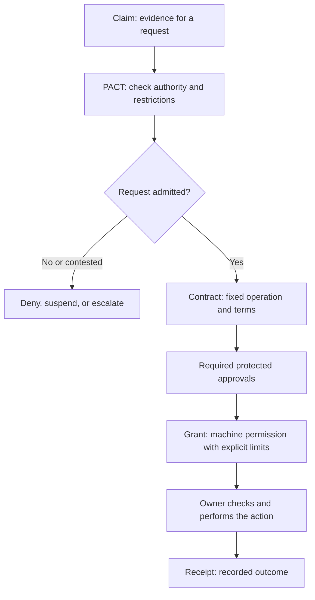
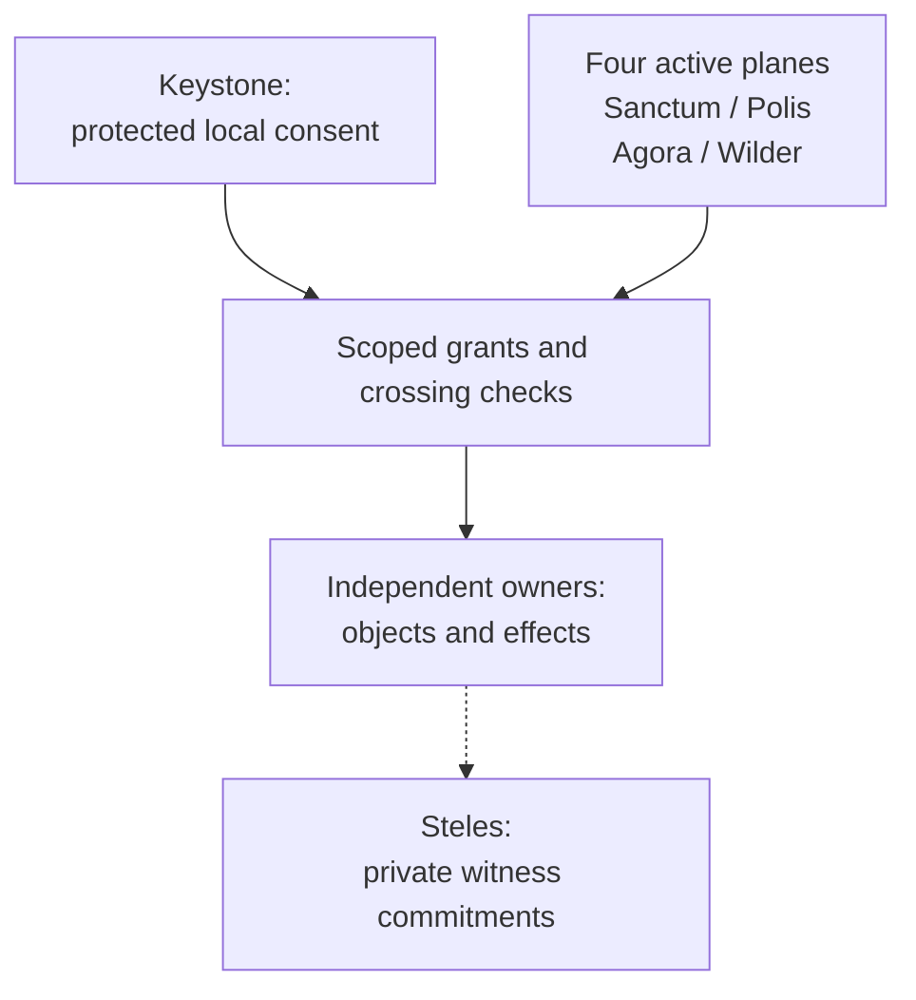
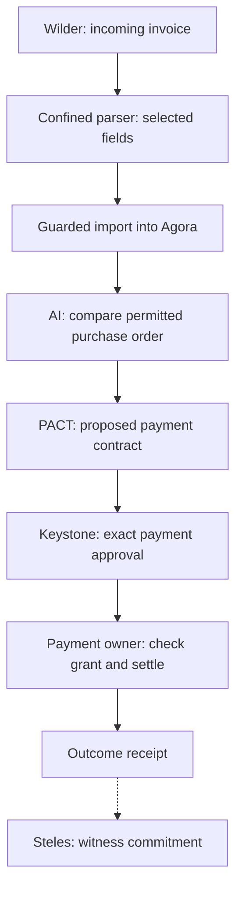

ASKA is a proposed architecture for computers and networks that enforce explicit limits on what each participant may do. A program may be allowed to read a document without being allowed to send it. A network may carry a request without authorizing it. An AI assistant may prepare a payment without holding the keys that approve it.

The specification describes how hardware, applications, and network services would enforce those limits together. **ASKA v5 is an architecture specification and research program.** The complete system remains a research target.

[Read the specification on GitHub](https://github.com/nshkrdotcom/ASKA) · [Start with the system architecture](https://github.com/nshkrdotcom/ASKA/blob/main/01_system_architecture.md)

## From a request to an authorized action

ASKA calls its protocol family the **Accord Suite**. PACT (Protocol for Authority, Consent, and Transactions) negotiates requests. It checks the evidence, restrictions, and approvals that apply to each operation. The result moves through four distinct records:

- **Claim:** evidence of identity, a relationship, a duty, or a right. A claim alone grants no access.
- **Contract:** the accepted terms for an operation: who participates, which data or devices it affects, and what restrictions and approvals apply.
- **Grant:** machine permission with explicit limits, derived from the contract and installed where the action is controlled.
- **Receipt:** a record of the outcome. Different receipts establish whether an action ran, data was stored or disclosed, or notice reached its recipient.

A grant specifies the permitted operation, data, recipients, expiration, and resource limits. The component that owns the data or controls the final effect checks that permission when it acts. Changing a pointer, route, prompt, or request descriptor cannot create a right to another owner's resources.

When claims conflict, PACT records the conflict and follows the applicable institutional procedure. That may mean denying a request, suspending it, or referring it for review. A signature establishes who signed a statement; it cannot settle whether a legal order is just or make unavailable encrypted data accessible.

[Authority rules](https://github.com/nshkrdotcom/ASKA/blob/main/03_authority_calculus_and_conflicts.md) · [PACT negotiation](https://github.com/nshkrdotcom/ASKA/blob/main/05_pact_negotiation_and_states.md)

## Four active planes and an independent witness

The reference endpoint separates personal, civic, commercial, and untrusted activity. These planes have different purposes and authority rules. A legitimate civic service still needs permission to receive personal data.

| Plane | Purpose | Boundary |
|---|---|---|
| **Sanctum** | Personal, family, and intimate professional activity | Civic and commercial services receive only specifically authorized information. |
| **Polis** | Civic identity, public services, elections, and legal process | Institutional credentials confer only their admitted scope. |
| **Agora** | Commerce, employment, contracts, payments, and enterprise services | Business access does not include personal or civic signing rights. |
| **Wilder** | Public Internet content, unknown peers, and legacy systems | Imported content stays in quarantine; its parser receives limited memory and output rights. |
| **Steles** | Independent evidence of actions and platform state | The witness receives only the evidence its role permits. |

This is the **4 + 1 endpoint**: four active planes plus the Steles witness plane. **Keystone** separately protects local consent, trusted display and input, key custody, and recovery. It cannot assume the decision rights of a court, employer, or other institution.

The arrows show where authority is checked. They do not depict physical connections. The native high-assurance design requires protected compute, memory, and physical communication resources for the active planes. Independent guards check access at the boundaries. Any deployment that shares equipment must state which guarantees that sharing weakens.

[Planes and Keystone](https://github.com/nshkrdotcom/ASKA/blob/main/10_societal_planes_and_keystone.md) · [Physical substrate](https://github.com/nshkrdotcom/ASKA/blob/main/11_physical_substrate_and_hardware.md)

## Execution with limited reach

An **Isolated Execution Stack (IES)** owns assigned physical compute and writable-memory resources for a trust domain. Within it, a **cell** runs for a bounded lifetime. Separate services own persistent objects and external effects, including storage, display, network publication, and device commands.

A parser can therefore process a hostile document with private scratch memory and a limited output buffer. Even if an attacker takes over the parser, the independent guards must continue to deny foreign memory and ungranted actions. Memory reuse, delayed device access, reset, and revocation are part of that requirement.

Applications connect these components through explicit contracts. The implementation may use an existing processor and compiler if the surrounding ownership and effect checks satisfy the required profile. Physical isolation and conformance still require their own evidence.

[Execution semantics](https://github.com/nshkrdotcom/ASKA/blob/main/12_execution_and_instruction_semantics.md) · [Memory lifecycle](https://github.com/nshkrdotcom/ASKA/blob/main/13_memory_ownership_and_lifecycle.md) · [Native applications](https://github.com/nshkrdotcom/ASKA/blob/main/16_native_applications_and_development.md)

## How the AI assistant works

The AI environment interprets requests, searches permitted context, drafts contracts, and builds candidate programs. Context owners decide what it can see. Separate checkers evaluate its proposals, and the services controlling each action enforce the resulting grants.

For an action requiring approval, Keystone presents the actual recipient, selected data, amount or resource limits, expiration, and relevant uncertainty. Approval binds to that fixed proposal. A changed payment account or substituted output needs a new authorization decision unless an existing bounded grant already covers the change.

Routine work can use standing grants: read a named collection, for example, and write drafts to a particular workspace within stated limits. The assistant cannot enlarge those limits, install its own grants, forge approval events, or approve a change to its own authority.

The security tests start with an attacker already controlling the planner, the component that proposes tasks. Owners and guards must enforce its limits while permitted tasks still work.

[AI environment and trusted interaction](https://github.com/nshkrdotcom/ASKA/blob/main/17_ai_environment_and_trusted_interaction.md)

## An invoice from the public Internet

An unknown supplier sends an invoice. Wilder receives it, and a disposable parser extracts selected fields within fixed size limits. Neither the supplier nor the parser has payment permission.

1. A guarded transformation proposes importing selected invoice fields into Agora.
2. An assistant compares those fields with a purchase order it is permitted to read.
3. PACT prepares a payment contract. Keystone displays the exact amount, recipient account, source information, restrictions, and fee.
4. After the required approval and business checks, a one-use grant permits the payment owner to debit the account or reject the request.
5. The user receives the outcome. Steles records a minimal witness commitment.

If tax reporting is required, a separate release contract defines the civic record sent to Polis. Settling an invoice does not give the revenue service access to the business's customer list.

[Worked transaction and attack scenarios](https://github.com/nshkrdotcom/ASKA/blob/main/32_end_to_end_transaction_traces.md)

## Networks and data release

ASKA extends purpose separation through household, campus, community, regional, and upstream networks. Local services may continue during some upstream outages. Their actual availability depends on installed links, reserved resources, power, and shared infrastructure.

Before data crosses a domain boundary, the source must authorize the exact output and its route. The recipient must separately agree to accept it. Permission to read is distinct from permission to export, print, or publish. The receiving system still confines its parser, even when the sender is authenticated.

Separate network names do not prove independent physical paths. A deployment claiming that independence must account for transceivers, queues, device memory access, switches, management, power, and upstream carriers. Shared infrastructure can remain an observation point or a common cause of failure.

[Network fabrics](https://github.com/nshkrdotcom/ASKA/blob/main/18_network_fabrics_and_gateways.md) · [Cross-domain release](https://github.com/nshkrdotcom/ASKA/blob/main/19_cross_domain_security_and_release.md) · [Protected delivery](https://github.com/nshkrdotcom/ASKA/blob/main/20_admission_transport_and_protected_delivery.md)

## Witness records and failure handling

Steles records protected evidence with a stated scope. It can retain a cryptographic commitment, which lets a later check verify a record without storing its plaintext in the witness log. Receipt types distinguish a proposed action from an executed action, a durable commit, a disclosure, or a delivered notice.

Witness outages follow the declared operating policy. An action may have to wait; a policy that permits bounded queued operation must report its reduced guarantee. A local record cannot establish that an offline recipient received notice.

Revocation stops future actions under the revoked permission. It cannot make a recipient forget information already received. A malicious insider can misuse an authorized disclosure, and a compromised guard or shared update authority can defeat guarantees within its reach. The threat model and dependency records must identify those limits.

[Steles and notice](https://github.com/nshkrdotcom/ASKA/blob/main/21_steles_witness_and_notice.md) · [Compromise and failure cases](https://github.com/nshkrdotcom/ASKA/blob/main/23_compromise_and_failure_cases.md)

## What the research must demonstrate

The specification defines staged work, from executable models to independently administered systems. Each stage must support useful authorized work while surviving the attacks it claims to contain.

| Stage | Required evidence |
|---|---|
| Semantic and application reference | Executable authority, ownership, delivery, and persistence models; an application harness with a hostile planner. |
| Separated physical demonstrator | Instrumented boards or FPGA partitions, bounded guards, safe memory reuse, and a real purpose crossing. |
| Competing engines and fabrics | Comparable measurements of execution and transport choices, including setup costs and faults. |
| Integrated substrate and toolchain | Evidence for the compiler, physical integration, debug controls, power, heat, repair, and manufacturing assumptions. |
| Independent realms in long-term operation | Different update and recovery roots, partition handling, root retirement, and continued limits through software evolution. |

A software model can test contract behavior without proving physical separation. A successful board experiment can establish properties of that apparatus without proving production cost or independence from its administrator. Results must distinguish requirements satisfied, assumed, unestablished, or violated.

The open work includes usable approval interfaces, authority conflicts, crash and revocation behavior, hardware independence, implementation cost, and useful applications that do not accumulate broad privileges. The research program must measure these properties before claiming success.

[Research program](https://github.com/nshkrdotcom/ASKA/blob/main/28_research_program_and_realizations.md) · [Validation and costs](https://github.com/nshkrdotcom/ASKA/blob/main/25_validation_and_cost_models.md) · [Conformance tests](https://github.com/nshkrdotcom/ASKA/blob/main/27_conformance_tests_and_vectors.md)

## Read the technical specification

The [GitHub repository](https://github.com/nshkrdotcom/ASKA) contains 34 chapters covering authority, institutions, hardware, applications, networks, accountability, deployment, and validation.

Start with [system architecture](https://github.com/nshkrdotcom/ASKA/blob/main/01_system_architecture.md) and [requirements and threat model](https://github.com/nshkrdotcom/ASKA/blob/main/02_requirements_and_threat_model.md). Use the [glossary](https://github.com/nshkrdotcom/ASKA/blob/main/31_glossary_and_term_registry.md) for terminology and the [transaction traces](https://github.com/nshkrdotcom/ASKA/blob/main/32_end_to_end_transaction_traces.md) to follow the rules through complete workflows. The [formal model sketch](https://github.com/nshkrdotcom/ASKA/blob/main/33_formal_properties_and_model_sketch.md) states the safety and liveness obligations that further work must establish.
